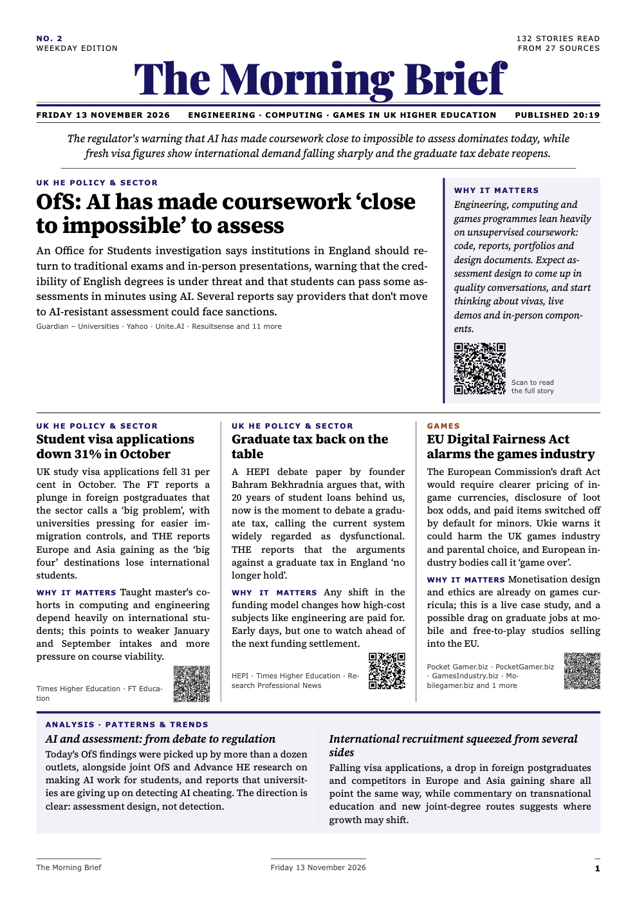
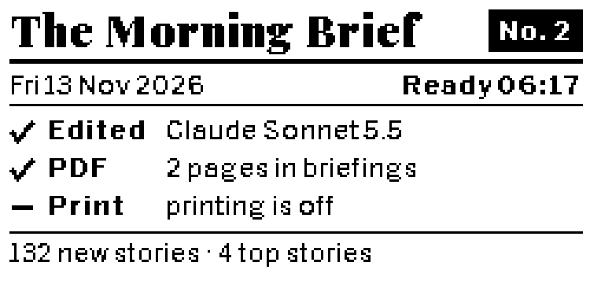

# The Morning Brief

A daily, AI-edited newspaper about **engineering, computer science and games in UK higher education**. Every weekday morning it reads about 30 news feeds and asks Claude to pick out what matters. It then lays the result out as a two-page A4 PDF that looks like a broadsheet: top stories and analysis on the front, news in brief on the back.

It's built to run unattended on a Raspberry Pi. It costs about 5p a day in API calls, can print itself on a network printer, and can show its status on a small e-ink screen.

<p align="center">
  
</p>

## What you get

- **A lead sentence** that sums up the day.
- **Top stories**, each with a short summary, *why it matters to you* and a QR code linking to the original.
- **News in brief**, grouped by section: UK HE policy & sector, Engineering, Computer science & AI, Games, Research & funding.
- **Patterns and trends** across stories and across the last two weeks.
- **Worth reading in full**: up to three longer pieces, with QR codes.
- **One thing for today**: a single practical suggestion based on the news.

It's styled in University of Huddersfield colours. The section colours match the SCE open day interface. The University logo isn't included in this repository, so before you run it on your own hardware you'll need to add your own logo (see [Making it yours](#making-it-yours)). Without one, the masthead shows the title in text only.

## How it works

`./brief.sh run` does three things:

1. **Gather.** It fetches every feed in [`config/sources.yaml`](config/sources.yaml) and keeps only stories published since the last briefing that haven't been covered before. Monday's issue covers the weekend. After time away, it catches up on up to a week.
2. **Edit.** It sends the stories, the reader [profile](config/profile.md) and the headlines from the last two weeks of briefings to Claude through the Anthropic API, in a single request. Claude merges duplicates, decides what matters and writes the briefing. The reply comes back in a fixed JSON format and is checked before use.
3. **Publish.** It lays out the PDF with WeasyPrint, trimming the least important items until it fits on two pages. It saves the PDF to `OUTPUT_DIR` and prints it if printing is on.

If the AI step fails (no internet, or the model declines), you still get a plain list of headlines. Those stories aren't marked as read, so the next run edits them properly.

### What counts as new

- **Exact repeats are dropped before the AI sees them.** Every headline that makes it into a briefing is remembered for 60 days, compared ignoring case and punctuation.
- **Follow-ups are left to the editor.** Claude sees every headline from the last two weeks of briefings, with instructions to repeat a story only when there's genuinely new information, and to say when a story continues an earlier one. To make it stricter or looser, add a line to [`config/profile.md`](config/profile.md).

## Requirements

- Python 3.11 or newer, and Pango (for WeasyPrint).
- An [Anthropic API key](https://platform.claude.com).
- Optional: a network printer that accepts IPP (most modern printers do), or a Pimoroni Inky pHAT.

### Cost

One API call per issue, of about 15,000–20,000 tokens in and 3,000 out:

| `CLAUDE_MODEL` | Per day | Per year (weekdays) |
|---|---|---|
| `claude-sonnet-5-5` (default) | ~5p | ~£12 |
| `claude-haiku-5-5` | ~0.5p | ~£1 |
| `claude-opus-5-5` | ~12p | ~£30 |

Each run logs its token count and rough cost. It's worth setting a monthly spend limit on the key.

## Quick start (Mac or Linux)

```bash
git clone https://github.com/drdukegledhill/dailybriefing.git morning-brief
cd morning-brief
cp .env.example .env            # then add your ANTHROPIC_API_KEY
python3 -m venv .venv && .venv/bin/pip install -r requirements.txt
./brief.sh run --preview
```

On a Mac, install Pango first with `brew install pango`. The PDF lands in `briefings/`.

`--preview` edits the last 30 hours of news without printing, and without counting as a real issue, so it's safe to run as often as you like. Add `--model claude-haiku-5-5` to compare models.

## Running it on a Raspberry Pi

Any Pi that runs **64-bit Raspberry Pi OS** will do; a Pi 3B is plenty. The Pi only fetches feeds, makes one API call and lays out the PDF.

1. Copy the project to the Pi (`git clone` as above, or `rsync` from another machine).
2. Run the installer:
   ```bash
   cd ~/morning-brief && ./pi/install.sh          # add --inky if you have an Inky pHAT
   ```
   It installs the system packages and the Python environment. It also sets up a systemd timer for **06:15, Monday to Friday**. If the Pi is off at that time, the run happens as soon as it's back on.
3. Add your API key to `.env`, make sure the time zone is right (`sudo timedatectl set-timezone Europe/London`), then test it:
   ```bash
   ./brief.sh run --preview
   ```

| | |
|---|---|
| Make today's issue now | `sudo systemctl start morning-brief` |
| See what happened | `journalctl -u morning-brief -n 50` |
| When it runs next | `systemctl list-timers morning-brief.timer` |
| Change the time | `MORNING_BRIEF_TIME="Mon..Fri *-*-* 07:00:00" ./pi/install.sh` |

### Sharing the PDFs

`OUTPUT_DIR` in `.env` sets where each day's PDF goes; by default it's `briefings/`. To read them from other devices, either share that folder with Samba, or mount a NAS share on the Pi and point `OUTPUT_DIR` at it.

### Printing

Set `PRINT=true` and `PRINTER_URI` (for example `ipp://192.168.1.50:631/ipp/print`) in `.env`. The PDF goes straight to the printer over IPP, with no drivers or CUPS needed. It prints double-sided and in colour by default, or set `PRINT_COLOUR=monochrome`.

```bash
./brief.sh printer           # can it be reached? toner levels
./brief.sh printer --test    # also print the latest briefing
```

### Status screen (Inky pHAT)



With a Pimoroni Inky pHAT and `INKY=true`, the screen shows:
- the issue number and date
- when the run started and finished
- a tick, cross or dash for each step: edited by Claude, PDF saved, print sent
- the number of stories, or what went wrong (in red)

E-ink holds the picture without power, so the last status stays up all day. If the screen has a problem, the briefing carries on regardless.

```bash
./brief.sh screen --sample              # draw a made-up status
./brief.sh screen --sample --png s.png  # or save it as a picture, without the screen
```

## Making it yours

- **[`config/profile.md`](config/profile.md)** tells the editor who you are, what matters and what to ignore. It's the most effective thing to change.
- **[`config/sources.yaml`](config/sources.yaml)** lists the feeds, with optional include and exclude filters. Sites without usable feeds are covered through Google News search feeds. Run `./brief.sh sources` to check every feed works.
- **[`.env.example`](.env.example)** lists every setting: model, effort, output folder, page limit, catch-up window, printing, screen, masthead title.
- **[`templates/digest.html.j2`](templates/digest.html.j2)** is the layout. The colours are at the top of its styles.
- **[`digest/editorial.py`](digest/editorial.py)** holds the editor's rules and the JSON schema for the reply.
- **Your logo** goes in `templates/brand/logo.png` (a PNG with a transparent background, about 4:1 wide). It isn't included in the repository, and git ignores that folder, so your own brand files stay out of it too. You may also want to change the University colours at the top of the template.

### Sources included

| Area | Feeds |
|---|---|
| UK HE sector | Wonkhe, HEPI, Guardian Universities, BBC Education, DfE, FT Education, Inside Higher Ed (US, capped) |
| Via Google News | Times Higher Education, OfS, UUK, Jisc, Advance HE, QAA, HESA, UCAS, University World News |
| Engineering | Royal Academy of Engineering, Engineering Council, EngineeringUK, IMechE, IET, The Engineer |
| Computing & AI | CPHC, Computer Weekly, The Register (filtered), DSIT, UK university computing news |
| Games | GamesIndustry.biz, Game Developer, PocketGamer.biz, MCV/Develop, UK games industry and education news |
| Research & funding | UKRI, EPSRC, Innovate UK, REF, arXiv (computing and engineering education) |

## Project layout

```
brief.sh              run the tool: run / sources / printer / screen
pi/install.sh         set up a Raspberry Pi with a daily timer (--inky for the screen)
config/               the feeds and the reader profile
digest/
  fetch.py            read the feeds
  editorial.py        the editor's rules, the reply schema, checking the reply
  ai.py               the Claude API call
  render.py           HTML → PDF, trimmed to fit
  printing.py         IPP printing, no drivers
  screen.py           Inky pHAT status screen
  store.py            SQLite memory of past issues and seen stories
templates/            the layout and fonts; your logo goes in templates/brand/
data/                 created on first run: memory, archive, the day's request and reply (not in git)
briefings/            your PDFs (not in git)
```

## Licence

The code is released under the **[PolyForm Noncommercial License 1.0.0](LICENSE)**. You're free to use, change and share it for personal use, research, education and other noncommercial purposes. Commercial use isn't permitted.

These parts are not covered by that licence:
- **Logos.** No logo is included. The University of Huddersfield's name and colours remain the University's, and you'll need to supply your own logo.
- **The fonts** (`templates/fonts/`) are Playfair Display, Source Serif 4 and Libre Franklin, under the SIL Open Font License 1.1. Their licences are alongside them.
- **News content** in generated briefings belongs to its publishers. The briefing summarises it and links back to the originals.
